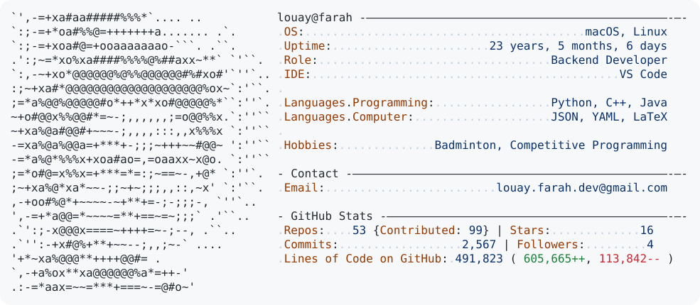

<a href="https://github.com/louayfarah">
  <picture>
    <source media="(prefers-color-scheme: dark)" srcset="https://raw.githubusercontent.com/louayfarah/louayfarah/main/dark_mode.svg">
    
  </picture>
</a>

Card refreshed daily by GitHub Actions. Based on <a href="https://github.com/Andrew6rant/Andrew6rant">Andrew6rant's profile README</a>.
